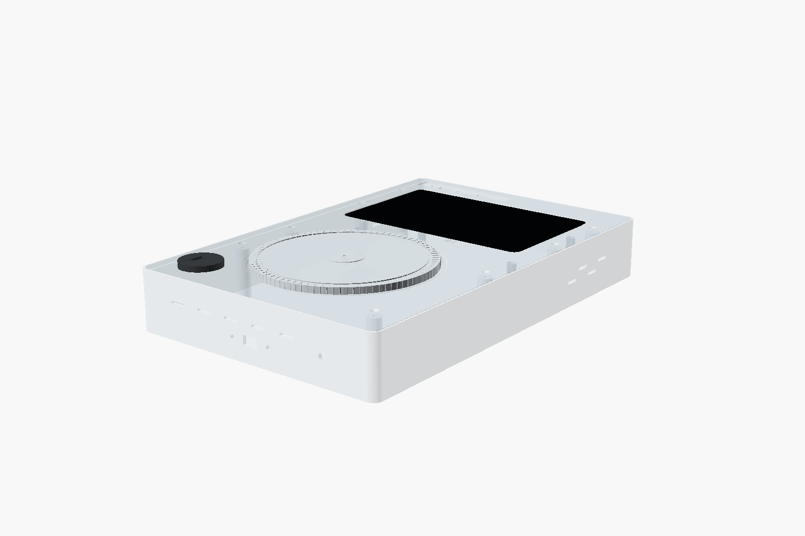
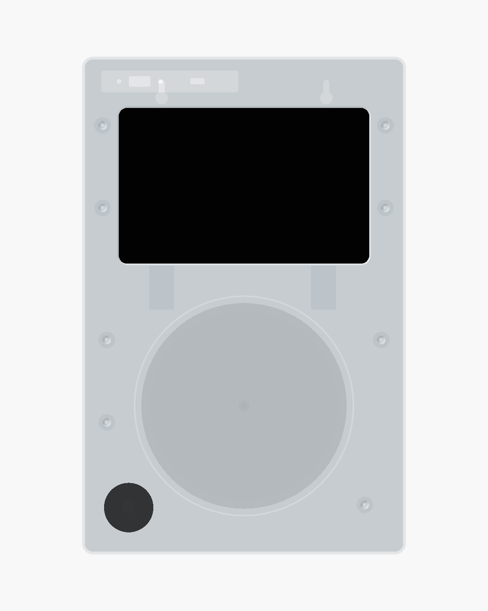
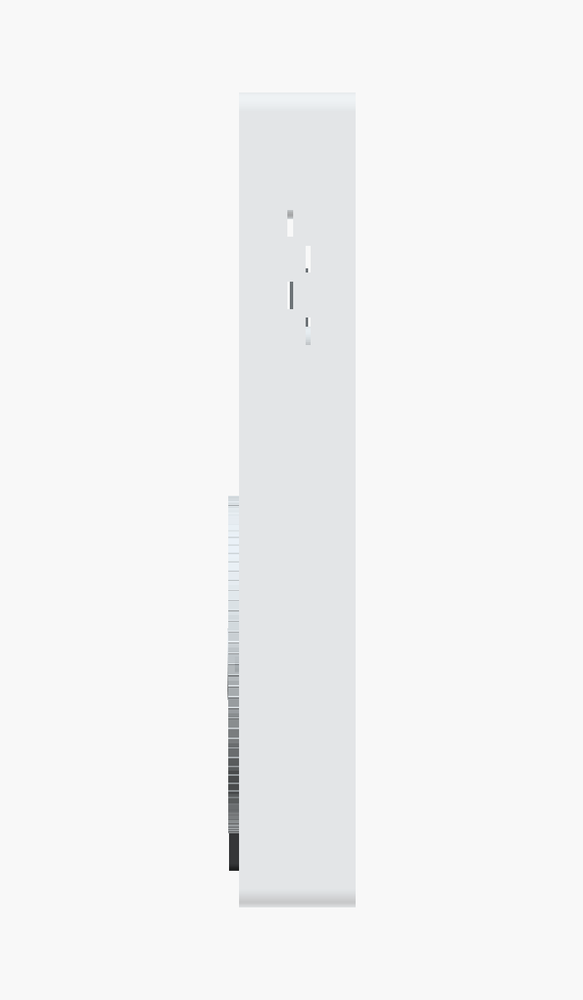
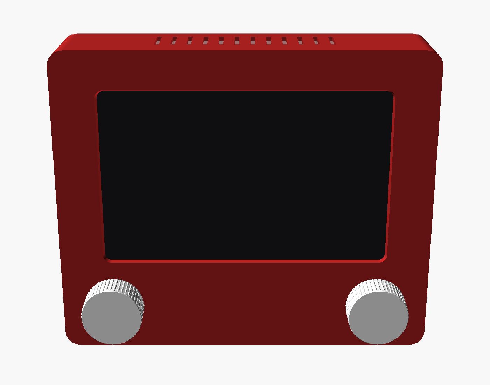

# Enclosures

Both cases use a Raspberry Pi 5 and the 7" touch display. The wall player
has two rotary encoders. The club shell has one encoder under the platter
and a play/pause key. The wiring and the software setup below are shared.

- **[Club shell](#club-shell)** — a flat wall player in the shape of an
  XDJ-1000, printed clear so the boards show through.
- **[Wall player](#wall-player)** — the first case. Etch A Sketch shaped, and
  it hangs on the wall.

# Club shell

A rectangular box that hangs on the wall. The face is flat and parallel to
the wall, the way an XDJ-1000 is: there is no slope. The display sits in the
upper half, a flat jog platter sits below it, a play/pause key sits in the
bottom-left corner, and the USB ports sit in a pocket along the top edge.
Nothing on the shell is labeled.

It is 236 × 362 × 52 mm. The platter is 150 mm across, with a knurled grip,
a ring, and a small center pad, and its top is flat. It is not a copy of a
Pioneer player. It only has the controls this project uses, and it has no
branding.

The clear shell is the other reference: the unlabeled transparent
CDJ-2000NXS2 Virgil Abloh showed in 2019, the one you can see the mechanism
through. Printed clear PETG comes out frosted. Clear resin, polished, is
closer to that piece. Skip metal-filled filament either way. It blocks
Bluetooth. Print the play key in a dark filament so it reads against the
clear face.







- **Jog platter:** browse. Turn to scroll, press to select, hold to go back.
- **Play key:** play or pause. A printed cap over a momentary switch.
- **Top edge:** USB-A and USB-C, in a recessed pocket above the screen.
- **Bottom edge:** the power cable leaves through a notch, with a 3.5 mm
  jack beside it. Set `audio_jack_d = 0` in the model to leave the jack out.
- **Volume** is on the touchscreen. There is no volume knob.

The model is `cdj-shell/shell.scad`. Open it in OpenSCAD and press F5. The
body and the face are each split in two, so every part fits a 250 × 210 mm
bed. To export one for printing, set `part` at the top, press F6, and use
File > Export > STL. The command lines are in the file header. Every part
is already oriented for the bed, and none of them need supports. Two keyholes
in the wall side let it hang on a pair of screws, 120 mm apart.

| Part | `part` value | Quantity |
| --- | --- | --- |
| Body, lower half | `body_lower` | 1 |
| Body, upper half | `body_upper` | 1 |
| Face, lower half | `face_lower` | 1 |
| Face, upper half | `face_upper` | 1 |
| Jog platter | `jog` | 1 |
| Play key | `play` | 1 |
| Seam plate | `splice` | 2 |
| Face alignment pin | `pin` | 2 |

Screws are M3, driven straight into the plastic: eight M3×12 flat heads
through the face into the posts, and four M3×8 pan heads through the seam
plates into the floor. The encoder, the USB leads and the jack bring their
own nuts and screws.

**Putting it together**

1. Prove the electronics on the bench first. The wiring table and the
   software setup in the wall-player section below cover the display and the
   encoder. The platter is the left-hand encoder in that table. The play key
   is a momentary switch on pin 22 (GPIO 25), the pin that table uses for
   the volume switch, wired to ground.
2. Screw the two body halves together with the seam plates. The plates sit
   on the pads inside the floor, one left and one right, and the screws go
   in from above.
3. Set the display onto the four posts in the upper half, glass toward the
   room. A scrap of foam on each post takes up the tolerance.
4. Fit the encoder to the face from inside, with the nut in the recess, and
   screw the USB sockets into the pocket. Mount the play switch behind the
   round hole so the key's stem lands on it.
5. Tap the two pins into one face half, bring the halves together, and set
   the face into the rim. The window lip captures the display. Screw the
   face down.
6. Push the platter onto the shaft and drop the play key into its hole.
   Zip-tie the power lead through the two holes beside the bottom notch.

The face is 4 mm thick, and the plastic under the encoder nut is 1.6 mm.
If your encoder's thread is shorter than that, lower `panel_t`.

# Wall player

A Raspberry Pi 5 and a 7" touchscreen in an Etch A Sketch style case. Two big
knobs sit in the bottom corners, the USB ports are on the right side, and the
case hangs on the wall. It runs this app full-screen and plays to Bluetooth
speakers.



- **Left knob (browse):** turn to scroll, press to select, hold to go back.
- **Right knob (volume):** turn for volume, press to play or pause.
- **Right side:** one USB-A and one USB-C port for DJ USBs, plus an optional
  3.5 mm audio jack for wired speakers.
- **Bottom:** the power cable leaves through a notch in the back edge.

Nothing in this build needs soldering.

## Parts and budget

Prices are US list prices as of November 2026. Raspberry Pi prices have
roughly doubled since 2025 because of memory costs, so check them again
before you order.

| Part | Notes | Price |
| --- | --- | --- |
| Raspberry Pi 5, 4GB | Enough for this app. The 8GB is $175. | $110 |
| Raspberry Pi Touch Display 2, 7" | Comes with the ribbon cable, the power cable and M2.5 screws | $60 |
| Raspberry Pi 27W USB-C power supply | The 27W one lets the USB ports supply full current to USB drives | $14 |
| Raspberry Pi Active Cooler | The Pi 5 gets hot in a closed case | $5 |
| microSD card, 64GB, A2 rated | SanDisk Extreme or the Raspberry Pi branded card | $15–25 |
| KY-040 rotary encoder modules (pack of 5) | Come with pins already attached, so no soldering. Spares are useful. | $8–10 |
| Female-to-female jumper wires, 20–30 cm | Connect the encoders to the Pi | $6 |
| Panel-mount USB-A extension, about 30 cm | USB-A socket on the case, plug into the Pi | $8–12 |
| Panel-mount USB-C socket to USB-A plug cable, about 30 cm | Must carry data (USB 3), not just power | $8–12 |
| M3 × 10 mm pan-head screws (assortment) | 8 for the case and the display retainers | $8–10 |
| Digital calipers | For measuring parts before you print | $15–25 |
| PETG filament, 1 kg | If you print the case yourself | $20–25 |

**Optional upgrades:**

| Part | Notes | Price |
| --- | --- | --- |
| 2 × aluminium knobs, about 40 mm, 6 mm D-shaft | Much nicer feel than printed knobs | $15–40 |
| USB audio adapter and 3.5 mm panel-mount extension | Wired speakers. The Pi 5 has no headphone jack. | $15–20 |
| Online print service instead of printing yourself | Nylon (MJF) or resin looks and feels more like a product | $60–150 |

**Budget:** about **$300** for the basic build printed yourself, and about
**$420–450** with metal knobs, wired audio and a professional print. Add $65
for the 8GB Pi, plus tax and shipping.

You already need to own, or borrow: a small Phillips screwdriver, a computer
with a microSD card reader, a Bluetooth speaker, and two wall screws with
anchors.

## Wiring

The display's power cable goes on GPIO pins 2 and 6, as in Raspberry Pi's
instructions. Each encoder takes five jumper wires. Pin numbers are the
physical pin numbers on the 40-pin header.

| Encoder pin | Left knob (browse) | Right knob (volume) |
| --- | --- | --- |
| `+` | Pin 1 (3.3 V) | Pin 17 (3.3 V) |
| `GND` | Pin 9 (ground) | Pin 20 (ground) |
| `CLK` | Pin 11 (GPIO 17) | Pin 16 (GPIO 23) |
| `DT` | Pin 13 (GPIO 27) | Pin 18 (GPIO 24) |
| `SW` | Pin 15 (GPIO 22) | Pin 22 (GPIO 25) |

> **Use the 3.3 V pins for the encoders, never the 5 V pins.** The Pi's GPIO
> pins only tolerate 3.3 V, and the KY-040 passes its supply voltage
> straight to them.

## Build order

### 1. Test everything on the desk first

Before printing anything, get the electronics working loose on a table:

1. Attach the Pi to the back of the display, with the ribbon cable and the
   power cable, following
   [Raspberry Pi's guide](https://www.raspberrypi.com/documentation/accessories/touch-display-2.html).
2. Set up the software (below) and confirm the app plays to your Bluetooth
   speaker.
3. Wire one encoder and check it with the test in step 6 of the software
   setup.

This way, if something doesn't work, you know it isn't the case.

### 2. Measure your parts, then adjust the model

The case is a parametric OpenSCAD model in `enclosure/enclosure.scad`. Get
[OpenSCAD](https://openscad.org) (free), open the file, and check these
numbers at the top against your actual parts with calipers:

| Setting | What to measure |
| --- | --- |
| `disp_t` | Display thickness at its edges, from the glass to the back |
| `shaft_flat` | Encoder shaft, across the flat side of the D |
| `usb_a`, `usb_c` | Opening size and screw spacing of your panel-mount connectors |
| `audio_jack_d` | Thread size of the panel-mount 3.5 mm jack (set `audio_jack_u = 0` if you skip it) |

Press F5 to preview after each change. To export a part for printing, set
`part` at the top to `"front"`, `"back"`, `"port_plate"`, `"retainer"` or
`"knob"`, then press F6 and use File > Export > STL.

### 3. Print

| Part | Quantity | Rough print time |
| --- | --- | --- |
| `knob` | 2 | 1–2 h each |
| `port_plate` | 1 | under 1 h |
| `retainer` | 4 | minutes |
| `back` | 1 | 3–5 h |
| `front` | 1 | 10–18 h |

- **Print the small parts first.** Check that the knob fits the encoder
  shaft and that the connectors fit the port plate. They're quick to
  reprint.
- **Bed size:** the front and back are 240 × 200 mm, so they need a printer
  with a bed of at least 250 × 210 mm, such as a Prusa MK4 or Core One, or a
  Bambu A1, P1S or X1. An Ender 3 is too small.
- **Settings:** PETG (PLA works for a first test, but it softens near a warm
  Pi), 0.2 mm layers, 3 walls, 15–20% infill, **no supports**. Every part is
  already oriented flat side down.
- **Avoid metal-filled filament or metallic paint.** They can block
  Bluetooth.
- **Never printed before?** Makerspaces and many public libraries have
  printers and people who will help. Online services (Craftcloud, JLC3DP,
  PCBWay) print from the STL files and ship the parts to you.

### 4. Assemble

1. Lay the front shell face down. Drop the display in glass first; the raised
   frame centres it.
2. Screw the four retainers onto the posts beside the display so they press
   on its edges. Snug, not tight.
3. Attach the Pi to the back of the display with the included M2.5 screws,
   and connect the ribbon cable and the power cable.
4. Push each encoder through its hole from the inside, and fit the washer and
   nut from the front. Push the knobs on. Left knob is browse, right knob is
   volume, as seen from the front.
5. Wire the encoders to the Pi (see the wiring table).
6. Screw the USB-A and USB-C connectors (and the audio jack, if used) to the
   port plate. Slide the plate into its guides on the right wall from the
   open back, and plug the other ends into the Pi.
7. Plug the power cable into the Pi and lay it in the notch in the bottom
   wall.
8. Screw on the back plate with four M3 screws.
9. Put two screws in the wall, 120 mm apart and level. Hook the keyholes on
   the back over them, then slide the case down.

## Software setup

1. **Flash the card.** Use [Raspberry Pi Imager](https://www.raspberrypi.com/software/)
   to write **Raspberry Pi OS (64-bit)**, the desktop version, to the
   microSD card. In Imager's settings, set a username, your Wi-Fi and enable
   SSH.
2. **Rotate the screen.** The display is portrait by default. Go to
   Preferences > Control Centre > Screens, right-click the display (labelled
   `DSI-1`), and under Orientation choose Left or Right, whichever puts the
   knobs at the bottom. Then select Apply.
3. **Pair the speaker.** Tap the Bluetooth icon in the top bar > Add Device.
   Then right-click the speaker icon and pick the Bluetooth speaker as the
   output.
4. **Install the app:**

   ```sh
   sudo apt update && sudo apt full-upgrade -y
   curl -fsSL https://deb.nodesource.com/setup_22.x | sudo -E bash -
   sudo apt install -y nodejs git
   git clone https://github.com/maxmarfuggi/Dj-MP3-Player.git ~/dj-mp3-player
   cd ~/dj-mp3-player
   npm install
   npm start
   ```

   USB drives mount automatically under `/media/<user>`, which is where the
   app already looks on Linux. FAT32 and exFAT drives work. Mac-formatted
   drives need `sudo apt install hfsprogs`, and APFS drives can't be read.
5. **Start the app at boot** by adding a desktop autostart entry:

   ```sh
   mkdir -p ~/.config/autostart
   cat > ~/.config/autostart/dj-mp3-player.desktop <<'EOF'
   [Desktop Entry]
   Type=Application
   Name=DJ MP3 Player
   Exec=bash -c 'cd ~/dj-mp3-player && npm start'
   EOF
   ```

6. **Check an encoder.** With one wired, install the GPIO library and turn
   the knob:

   ```sh
   sudo apt install -y python3-gpiozero
   python3 -c "from gpiozero import RotaryEncoder; from signal import pause; e = RotaryEncoder(17, 27); e.when_rotated = lambda: print(e.steps); pause()"
   ```

   The number should go up one way and down the other. If it goes the wrong
   way, swap the `CLK` and `DT` wires.

## Not built yet

The hardware will work as soon as it's assembled, but three pieces of
software are still missing:

- **A knob service**, a small program that reads the encoders and turns them
  into app controls, with the volume knob changing the system volume.
- **Knob-friendly navigation in the app**, a scroll-and-select mode with a
  clear highlight and big text. Today the UI expects a mouse or touch.
- **Full-screen start.** The window opens at 1100 × 720 instead of filling
  the screen.

## Making the knobs feel great

The knobs are the selling point, so here is the upgrade path:

1. **This build:** KY-040 encoders. A heavy 40 mm aluminium knob does most
   of the work, because weight makes even a cheap encoder feel smooth.
2. **Better encoders:** a Bourns PEC11R or ALPS EC11 with 24 detents gives
   crisper clicks. They need five solder joints each, which makes a good
   first soldering project with a $25 soldering kit. They use the same M7
   bushing and 6 mm D-shaft, so the case and knobs still fit.
3. **For a product:** a haptic knob, like the open-source SmartKnob project.
   A small motor creates programmable clicks: one per track while
   scrolling, a hard stop at 0% and 100% volume, a bump between playlists.
   That's the "wow" feature, but it's a much bigger project.

The red case with white knobs is fine for a personal prototype. For a
product, design your own look, because the Etch A Sketch appearance is
protected trade dress.
